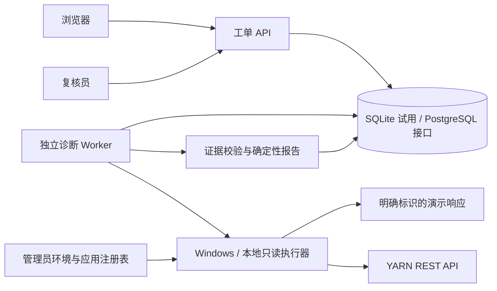

# 架构评审与首版范围

日期：2026-10-29；原始评审对应首版 `0.1.0`。原方案中的 Windows / WSL 配置属于用户设备记录，本次云环境不能验证该设备的网络与凭据。

> v0.2 补充：工单现已使用通用 target_type/target_id，YARN 退为专用适配器，参见[通用诊断对象](通用诊断对象.md)。新增一键启动器与旧数据库有限增量迁移；下文关于首版仅有 YARN 入口及仅创建初始表的描述为 v0.1 的历史边界，不代表 v0.2 的新增能力。

## 评审结论

保留原方案的 Windows 网络入口、WSL 控制面、只读优先、证据驱动和人工授权原则。需要优化的是实施顺序与可验证的接口边界：公司模型接入不应阻塞工单、队列、证据和只读工具开发；先用确定性诊断闭环验收这些基础能力，再接入模型，避免把“能对话”误当成“能诊断”。

| 原设计待明确处 | 优化方案 | 首版落实 |
| --- | --- | --- |
| Agent 与持久化流程职责交叠 | 状态机负责调度，诊断逻辑只产出报告，不直接操作环境 | API / Worker / diagnosis 分模块 |
| 模型网关协议尚未知 | 单独验收公司接口后实现适配；业务不预设 OpenAI 兼容 | 不伪造模型网关，不调用未知接口 |
| 工具参数与网络目标的信任边界 | 目标来自执行器管理员注册表，客户端只能传环境和应用 ID | 严格字段、固定路由、应用白名单、拒绝重定向 |
| 重启后如何处理在途请求 | 明确 collecting 与 collection_unknown，禁止启动时自动重放 | 人工 recover、原子领取、旧领取结果丢弃 |
| 报告何时可以发布 | 草稿、引用/摘要校验、人工复核与版本竞争检查分开 | awaiting_review → completed；仍可标记未定位 |
| 所有组件一次性建设成本大 | 每阶段提供独立可运行验收，MCP 与群入口延后 | 无 Redis/Celery/向量库依赖的最小队列 |

## 当前结构

API 受理请求并持久化 queued，Worker 通过条件更新领取任务，使用独立服务凭据请求执行器；执行器只提供注册动作，无 Shell、脚本生成执行、任意路径读取或任意 URL 输入。响应需逐字段匹配工单、环境、应用、工具及请求 ID 后才能保存。证据和报告在同一事务发布，调用失败或不确定时停止自动推进。

## 明确的能力边界

1. 当前是**只读诊断工作台骨架**，不是已完成的大模型自主排障系统。状态事实可核验，根因始终保留未定位，模型、日志检索和 Skill 规划后续接入。
2. 两个工具名称可调用同一 YARN 应用端点；首版 Worker 只调状态工具，未把 diagnostics 文本当作可信命令或已确认原因。容器日志、配置、版本核对没有实现。
3. 原始证据存数据库而非独立文件存储，以保证首版小响应的原子性。64 KiB 为每次采集预算，不是全局保留策略。大文件应改用对象存储、流式接收、哈希与持久化确认协议、磁盘低水位和保留期。
4. 单次采集有并发、网络超时和大小限制；尚无多环境调度配额、调用频率策略、全工单运行预算及硬截止。HTTP read timeout 是读间隔限制，不是整个请求的硬截止。
5. 初始表由 SQLAlchemy 创建；SQLite 持久性已列入测试。PostgreSQL 方言可配置，但需用实际 PostgreSQL 验收事务并发、备份与恢复，然后引入迁移管理，不能直接宣称生产就绪。
6. 共享角色令牌提供粗粒度身份区分，不是完整 RBAC。审计记录角色，不能识别实际个人。多人部署前需接入个人身份、环境权限和审计保留机制。
7. 证据摘要用于完整性检查，不是数字签名或不可篡改审计。没有自动脱敏、恶意内容清洗、时间窗口/组件版本一致性完整校验；现阶段原文不发送到模型，操作者仅看到固定格式状态及元数据。
8. 未实现变更操作，因而没有伪造审批、资源租约或回退能力。后续变更应采用独立执行身份，并在执行器验证审批摘要、前置基线、fencing token 和幂等执行记录。

## 后续实施顺序与验收

| 顺序 | 工作 | 完成条件 |
| --- | --- | --- |
| 1 | 在用户 Windows / WSL 部署首版 | NAT 地址发现、服务认证、持久化重启与实际只读 YARN 请求均通过 |
| 2 | PostgreSQL 与运维 | 迁移、限额、个人权限、备份恢复、systemd/Windows 服务启动验收 |
| 3 | 模型接入 | 提供脱敏协议，先验证 Windows 实际请求，再实现网关与结构化输出校验 |
| 4 | 首个 Flink on YARN Skill | 限量 diagnostics/日志/版本采集；报告区分事实、假设、原因与未知 |
| 5 | 变更控制 | 有身份审批、资源租约及代次、结果未知处理、回退与冲突测试后才注册变更工具 |
| 6 | 知识与入口 | 审核后的案例检索；最后增加 MCP、群机器人和更多分析分工 |

模型接入仍需原文第 12 节列出的请求、响应、认证、证书及配额信息，不能凭空假定协议。真实密钥通过环境设置或部署方安全配置提供，不放到 Git 或聊天中。
