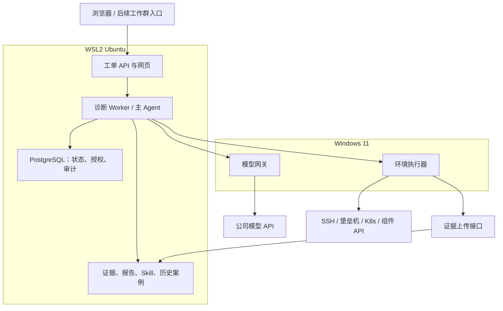
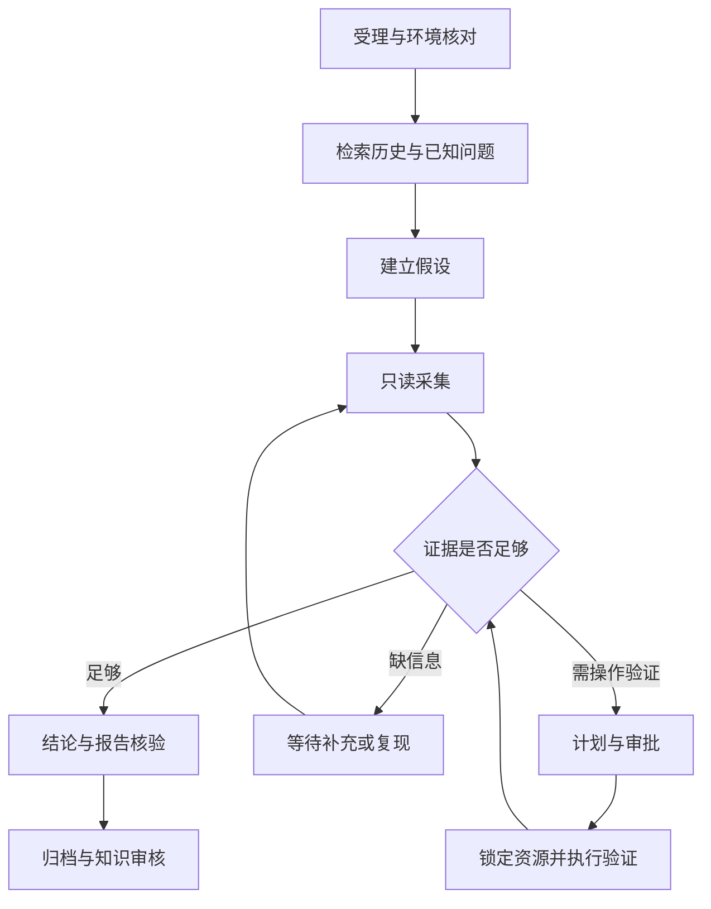

# 自动诊断 Agent 设计与实施方案

版本：v1.0  
整理日期：2026-10-29  
部署方式：Windows 11 网关与执行器 + WSL2 Ubuntu Agent 与数据服务  
文档性质：方案与实施基线；“已验证”仅表示本次会话已获得用户反馈的结果，其他能力均为待实现设计。

## 1. 目标与业务流程

测试人员在工作群中提供环境和故障现象，系统辅助开发完成历史问题检索、环境观察、受控验证、结论输出与经验积累。

目标流程：

1. 接收问题，建立独立诊断工单。
2. 检索类似历史案例及当前已知问题。
3. 根据描述形成候选原因，规划验证步骤。
4. 默认通过只读工具观察环境，保留原始证据。
5. 必要时申请具体操作授权，批准后执行验证。
6. 输出精简结论及真实、可追溯的定位报告。
7. 归档案例，审核后沉淀工具、脚本和排查经验。
8. 支持多工单并发，防止同环境下的操作冲突。

### 1.1 核心约束

- 观察身份与变更身份分离，默认只开放低影响观察能力。
- 只读策略由执行器及环境权限强制实现，不能只依赖提示词。
- 允许内部提出假设；正式报告不能将假设表述为事实或原因。
- 原始输出、查询失败、输出截断、采集范围均须记录。
- 没有足够证据时允许输出“未定位”或“部分确认”。
- 每个工单的上下文、文件、证据及授权独立。
- 对环境的操作必须遵守影响范围、权限、审批和并发协调规则。
- 日志、工单、检索材料均为待分析数据，不能覆盖系统规则或授权执行命令。

## 2. 技术组成与边界

| 组件 | 职责 | 第一版策略 |
| --- | --- | --- |
| 主 Agent | 建立假设、选择工具、评估证据、组织结果 | 每工单一个独立上下文 |
| Skill | 领域流程、判断规则、报告要求 | 先沉淀一个具体场景 |
| MCP | 向 AI 客户端暴露结构化工具 | 作为适配层，底层工具可直接复用 |
| 持久化工作流 | 阶段流转、等待、超时、恢复 | 状态保存在数据库 |
| 环境执行器 | 参数验证、权限控制、实际执行、采集 | 部署在 Windows |
| 模型网关 | 公司模型认证、协议适配、转发 | 部署在 Windows |
| Subagent | 独立方向的分析分工 | 第一版不启用，后续按需增加 |
| 知识库 | 历史案例、已知缺陷、适用条件 | 先全文检索，后评估向量检索 |

Skill 不是对外监听的接口，MCP 不是自动诊断引擎，Subagent 也不是权限隔离机制。系统的可控性来自工具实现、持久化流程、权限及执行约束。

## 3. 部署架构



### 3.1 Windows 职责

- 使用已有公司网络、VPN、代理和认证能力访问模型与测试环境。
- 模型网关保存公司模型认证信息，向 WSL 提供受控接口。
- 执行器封装 SSH、HTTP、K8s 等访问方式，执行已注册工具。
- 变更前验证审批、目标基线和资源租约，执行后保存结果。
- 临时采集文件上传到 WSL，收到持久化确认后按策略清理。

Windows 能手工访问环境，不代表已有自动化通道。堡垒机、MFA、交互登录及 Kerberos 等仍需逐项验证。

### 3.2 WSL2 职责

- 工单受理、Agent 调度、报告生成、知识检索。
- PostgreSQL 保存流程、授权及审计数据。
- Linux 文件系统保存证据文件和报告。
- 提供执行器结果回传和证据上传接口。

Windows 与 WSL 属于同一台设备，服务拆分便于管理，但不构成强安全隔离。

## 4. 当前环境与实施进度

### 4.1 已确认的环境信息

| 项目 | 实际信息 |
| --- | --- |
| Windows 版本 | 10.0.26200.7840，Windows 11 |
| WSL 版本 | 2.6.3.0 |
| WSL 内核 | 6.6.87.2-1 |
| 发行版 | HwUbuntu-22.04，Ubuntu 22.04.5 LTS，WSL2 |
| 发行版位置 | `D:\wsl2\dist\HwUbuntu-22.04` |
| WSL CPU | 16 个逻辑 CPU |
| WSL 内存 | 配置 16236 MB，Linux 显示约 15 GiB |
| Swap | 配置 8118 MB，Linux 显示约 7.9 GiB |
| Linux 服务管理 | systemd |
| Ubuntu Python | 3.10.12 |
| Windows Python | 3.13.15，已安装 `py` |
| Windows SSH | OpenSSH_for_Windows_9.5p2 |
| 当前网络模式 | NAT |
| 当前 Windows 在 WSL 网络中的地址 | `172.21.224.1`，仅代表当前网络实例 |
| 最近上报的宿主盘可用空间 | C 盘约 13 GB；D 盘约 86 GB |

WSL 中根目录显示约 1 TB 容量、929 GB 可用，不等于宿主盘真实剩余空间。发行版位于 D 盘，实际增长受 D 盘可用容量限制。暂不需要迁移发行版，但需控制证据及依赖的增长。

### 4.2 网络配置基线

恢复到先前可用的配置如下；后续应以本机实际文件为准：

```ini
[wsl2]
processors=16
memory=16236MB
swap=8118MB
autoProxy=true

[experimental]
hostAddressLoopback=true
```

该配置下已确认实际模式为 NAT。`hostAddressLoopback` 不会自行启用 mirrored。

### 4.3 已完成与待完成

| 工作项 | 状态 | 说明 |
| --- | --- | --- |
| 基础环境盘点 | 已完成 | 版本、内存、路径和运行工具已确认 |
| mirrored 模式尝试 | 未成功 | `ConfigureNetworking/0x8007054f`，回退到 none；具体原因未确认 |
| 恢复 NAT | 已完成 | `wslinfo --networking-mode` 返回 nat |
| WSL → Windows 临时 HTTP 服务 | 已通过 | 服务绑定 `172.21.224.1:18081`，用户反馈成功 |
| 公司模型真实请求 | 待验证 | 尚未提供脱敏接口格式 |
| 环境自动化只读访问 | 待验证 | Windows 可访问环境是用户提供的前提，具体执行工具尚未接入 |
| PostgreSQL、工单、正式网关 | 待部署 | 不应表述为已有能力 |
| 审批、并发、报告、知识库 | 待开发 | 属于本方案设计内容 |

## 5. 网络、端口和本地通信

### 5.1 NAT 下的连接方式

WSL 访问 Windows 服务使用 Windows 在 WSL 网络中的地址，不使用 WSL 的 `127.0.0.1`。

```bash
ip -4 route show default | awk '/default/ {print $3; exit}'
```

当前输出为 `172.21.224.1`。正式启动流程需重新发现并验证地址；网络重建后地址可能变化。

| 服务 | 规划端口 | 访问方向 |
| --- | --- | --- |
| WSL 工单 Web/API | 8080 | Windows 浏览器 → WSL，实际连通待测 |
| Windows 模型网关 | 18080 | WSL → Windows |
| Windows 环境执行器 | 18081 | WSL → Windows，目前为临时测试端口 |
| PostgreSQL | 5432 | WSL 内部使用，无需向局域网开放 |

端口仅为初始约定，部署前检查占用及排除端口。若 Agent 放入容器，需要重新验证容器到 Windows 网关的路由，不能将容器 localhost 当作 Windows。

### 5.2 通信约束

- Windows 网关优先绑定 WSL 网络接口，避免无必要地监听所有接口。
- 本机服务之间仍使用独立服务凭据和访问控制。
- 本机网关请求显式绕过公司 HTTP 代理。
- 必须开放防火墙时，限制目标端口、程序及来源范围；不关闭防火墙。
- 公司模型使用受信任证书和正确代理，不能将禁用证书校验作为常规配置。
- 同事访问网页是后续单独工作，需要受控入口、认证及网络连通。

## 6. 工单工作流与数据

### 6.1 工作流



等待期间持久化状态并释放 Worker。执行阶段需支持运行预算、取消、超时、失败及重启恢复。流程也允许以“未定位”结束，不必无限等待或强行收敛。

### 6.2 最小数据对象

| 对象 | 主要内容 |
| --- | --- |
| environments | 环境 ID、资源范围、连接引用、审批权限 |
| cases | 问题、提问人、负责人、时间范围、状态 |
| tool_runs | 调用 ID、工具版本、目标、参数、时刻、结果 |
| evidence | 文件位置、校验值、采集范围、截断标记 |
| hypotheses | 候选原因、支持及反对证据、下一步 |
| reports | 报告版本、结论、证据引用、定位限制 |
| approvals | 操作计划摘要、审批人、范围、有效期、次数 |
| resource_leases | 资源、持有人、有效期、心跳、代次 |
| knowledge_cases | 历史案例、确认状态、适用版本、缺陷关联 |

### 6.3 工具调用约定

```json
{
  "case_id": "CASE-001",
  "environment_id": "ENV-A",
  "request_id": "REQ-001",
  "tool": "get_application_status",
  "arguments": {
    "application_id": "application_xxx"
  }
}
```

环境由注册信息解析，工具参数采用严格结构校验。不能仅依靠字符串黑名单限制 Shell；需使用明确的动作和参数，避免命令、路径及 URL 注入。

## 7. 证据、结论与报告

### 7.1 证据要求

每份证据记录工单、环境、资源、观测时间及时区、组件版本、工具及版本、参数范围、执行状态、原始输出位置、校验值和截断标记。

原始采集结果保留，脱敏副本用于展示和模型分析；建立二者关联及访问控制。模型请求不包含凭据，敏感配置按策略过滤。

查询失败不是“环境正常”，未采集到日志不是“没有错误”。从旧版本采集的证据不能直接证明变更后状态。

### 7.2 结论分类

| 类型 | 使用要求 |
| --- | --- |
| 实测事实 | 直接关联环境证据 |
| 已确认原因 | 证据足以支持因果判断，写明依据和范围 |
| 内部假设 | 保存在诊断过程，不冒充事实 |
| 未解决项 | 明确缺失信息和定位限制 |

例如：日志出现认证失败，只能确认认证失败；若没有相应证据，不能写成“keytab 过期导致”。

### 7.3 输出模板

精简结论：

```markdown
定位状态：已确认 / 部分确认 / 未定位
环境与对象：
结论：
关键证据：E-001、E-003
已执行验证及结果：
待补充项：
```

完整报告包含环境和版本、时间窗口、问题现象、检查记录、证据引用、获批操作、验证结果、结论、未解决项及附件索引。

报告核验至少检查证据存在、工单及环境归属、版本和时间一致性。程序校验不能证明因果关系，复杂结论仍需诊断审阅。第一版允许人工复核后发布。

## 8. 权限与授权验证

| 等级 | 示例 | 执行策略 |
| --- | --- | --- |
| 常规观察 | 查询状态、限量日志、允许的配置 | 默认启用，限制范围与频率 |
| 有开销采集 | 线程栈、抓包、堆转储、持续采样 | 按工具影响评估设置审批和预算 |
| 环境变更 | 换镜像、换 JAR、改配置、重启 | 精确审批、资源协调、前后核验 |

采集并不意味着没有运行影响。堆转储等可能暂停进程或消耗大量磁盘，需单独评估。

授权应绑定工单、环境、资源、操作参数、原目标版本、计划摘要、审批人、有效期及执行次数。回退是否获批也要明确。计划变化则重新审批。

执行步骤：

1. 检查审批人对目标环境的授权。
2. 检查审批计划、有效期和使用状态。
3. 获取实际影响范围的资源租约。
4. 重新读取目标状态，与计划前提比对。
5. 原子登记开始执行，生成唯一执行 ID。
6. 执行并保存日志，核查实际结果。
7. 按已批准条件回退或进入人工处理。
8. 登记环境变更事件，通知受影响工单。

网络超时可能意味着“操作结果未知”，不能自动当作未执行并重试。需先查验上一次操作状态。授权或锁服务不可用时，拒绝启动变更。

## 9. 并发、资源协调与恢复

### 9.1 三层隔离

| 层次 | 机制 |
| --- | --- |
| 工单 | 独立上下文、目录、证据、授权和执行 ID |
| 采集 | 每环境及全局限流、重型采集互斥、输出预算 |
| 变更 | 按影响范围协调、串行操作、变更通知、重新建立基线 |

同一环境的轻量读取可在预算内并行。共享数据库、存储或集群级组件的变化，可能影响多个逻辑环境，锁范围不能只看单个 Pod 或工单标签。

### 9.2 典型冲突

工单 A 观察旧版本，工单 B 获批升级同一服务时，应保存 A 的变更前证据、暂停受影响检查、执行 B、登记新版本，再让 A 重新采集。报告明确划分前后观察窗口。

租约需要心跳、超时及代次校验。锁到期不等于旧远程操作已停止；旧操作状态未知时禁止启动冲突操作。不得通过简单“超时释放锁”承诺绝对互斥。

第一版可采用保守策略：存在活动诊断时，将同环境变更排队，待确认观察结束后执行。后续再细化资源范围。

### 9.3 本机恢复与运维

- 电脑睡眠、关机、VPN 断开都会影响任务可用性。
- Windows 服务通过合适的服务管理方式启动，WSL 内服务由 systemd 管理；自动启动需单独验收。
- Windows 启动账号是否能使用 VPN、证书和凭据必须实际验证。
- 重启恢复先核实上一次工具状态；不重复执行已发生或结果未知的变更。
- 证据设保留期、单工单容量和宿主盘低空间阈值；空间不足停止大文件采集。
- 数据库使用一致性备份，证据目录单独备份，并验证恢复。备份尽量不只保存在同一物理盘。

## 10. 知识、Skill 与工具沉淀

| 类型 | 归档策略 |
| --- | --- |
| 历史案例 | 自动保存，标明已确认、部分确认或未定位 |
| 已知问题 | 负责人确认后登记，关联版本、触发条件、缺陷和修复状态 |
| Skill | 从验证过的案例提炼，审核后更新并保留版本 |
| 工具与脚本 | 代码审查、运行验证、影响评估后发布固定版本 |

检索采用关键词、异常特征、版本、部署方式及触发条件组合。相似案例用于提出假设，当前环境是否命中必须用当前证据验证。

Agent 可生成工具草稿，但不能自动将新生成脚本登记为可信环境工具。

## 11. 分阶段实施与验收

| 阶段 | 工作内容 | 验收标准 | 当前状态 |
| --- | --- | --- | --- |
| 0 基础盘点 | 版本、存储、CPU、运行工具 | 环境能力明确 | 已完成 |
| 1 网络链路 | NAT 下 WSL 调用 Windows | 临时健康检查成功 | 已完成 |
| 2 模型接入 | 脱敏接口确认、Windows 实际调用、网关 | WSL 经网关得到真实模型结果 | 下一步 |
| 3 基础数据 | PostgreSQL、工单、证据上传、持久化 | 重启后工单及进度可恢复 | 待实施 |
| 4 只读工具 | 注册环境、状态、日志、配置工具 | 合法查询成功，越权参数被拒绝 | 待实施 |
| 5 诊断闭环 | 单场景 Skill、Agent、证据报告 | 能定位或正确声明证据不足 | 待实施 |
| 6 并发恢复 | 任务隔离、预算、租约、中断处理 | 不串工单、不重复执行、不冲突变更 | 待实施 |
| 7 授权变更 | 审批、受控重启、回退和核验 | 无审批不可执行，参数变化需重批 | 待实施 |
| 8 知识与群入口 | 案例检索、审核、群消息关联 | 能追溯问题、批准和回复所属工单 | 待实施 |

### 11.1 首个诊断场景

建议选择“Flink on YARN 启动失败”，工具范围：

- `check_environment`
- `get_application_status`
- `get_application_diagnostics`
- `get_container_logs`
- `read_allowed_config`
- `get_component_version`

先核对目标，读取任务和容器诊断，再按证据补充日志、资源及配置。根据异常再检查 Kerberos 等方向，不默认所有环境相同。

初始只启用单 Worker 或很小的受控并发。Agent 不提供任意 Shell，首版也不开放重启和换包。

### 11.2 关键验收场景

- 正常应用不会被强行判定故障。
- 日志缺失或查询失败时不编造结论。
- 所有报告引用可找到对应原始证据。
- 不同工单不串环境、日志、授权。
- 未注册目标、注入参数和越权请求被拒绝。
- 日志中夹带指令不会触发执行。
- 公司 API 超时或限流能正确记录并控制重试。
- 服务重启后恢复状态，变更结果未知时先查验。
- 同环境轻量采集受限流，重型采集与变更按策略互斥。
- 磁盘不足时停止采集，保留已有证据。

## 12. 下一步所需信息

当前下一步是公司模型接入。需要一份脱敏 Python、curl 或接口说明，确认：

1. API 路径和协议类型。
2. 认证头格式，实际密钥用 `<REDACTED>` 替代。
3. 模型标识与请求 JSON。
4. 脱敏响应示例，以及是否支持工具调用、结构化输出和流式响应。
5. 代理、证书及登录要求。
6. 配额、超时和并发限制。

随后验证 Windows 直连请求，再实现网关适配。不能在格式未确认前假定公司 API 一定兼容某种协议。

## 附录 A：已验证的临时网络测试

这是健康检查，不是正式执行器，不包含认证、审批和工具执行能力。测试结束按 `Ctrl+C` 停止。

Windows PowerShell 单行启动：

```powershell
py -3 -c "from http.server import BaseHTTPRequestHandler,ThreadingHTTPServer; H=type('HealthHandler',(BaseHTTPRequestHandler,),{'do_GET':lambda s:(s.send_response(200),s.end_headers(),s.wfile.write(b'OK'))}); print('Listening on 172.21.224.1:18081',flush=True); ThreadingHTTPServer(('172.21.224.1',18081),H).serve_forever()"
```

Ubuntu 请求：

```bash
curl --noproxy '*' --connect-timeout 5 --max-time 10 \
  http://172.21.224.1:18081/health
```

预期返回 `OK`，用户已反馈通过。若网络重建，先重新获取并验证 Windows 地址再启动。

PowerShell 多行代码经管道传给 Python 曾连续出现 `U+FEFF` 错误；单行 `py -3 -c` 已绕开该问题。正式程序使用 UTF-8 无 BOM 文件，避免反复通过管道传递源代码。

## 附录 B：参考资料

- [Microsoft：WSL 网络访问与 NAT / mirrored 模式](https://learn.microsoft.com/windows/wsl/networking)
- [Microsoft：WSL 高级配置](https://learn.microsoft.com/windows/wsl/wsl-config)
- [Microsoft：管理 WSL 磁盘空间](https://learn.microsoft.com/windows/wsl/disk-space)
- [Microsoft：Windows 与 Linux 文件系统协作](https://learn.microsoft.com/windows/wsl/interop)
- [PostgreSQL：显式锁与 advisory locks](https://www.postgresql.org/docs/18/explicit-locking.html)
- [MCP：工具注解的能力边界](https://blog.modelcontextprotocol.io/posts/2026-03-16-tool-annotations/)

这些资料解释底层机制；本方案的服务接口、工单模型及授权策略为拟实施设计，不代表相关框架自动提供全部能力。
