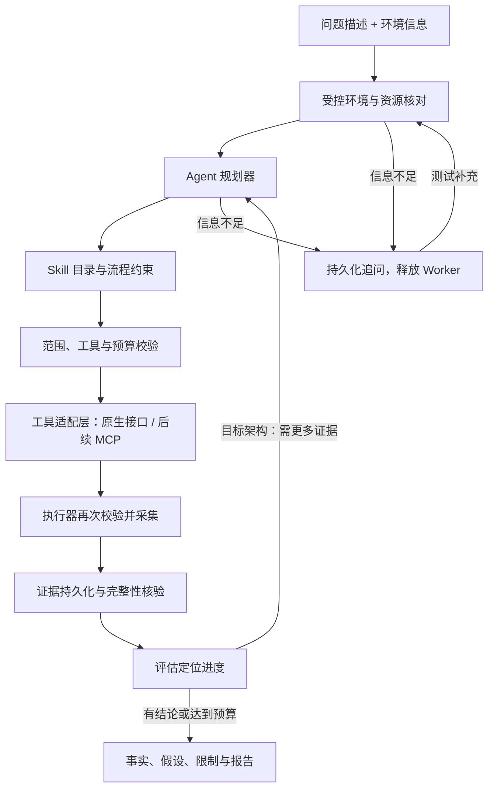

# 自动诊断入口与调度架构

## 用户流程

测试只提供问题与掌握的环境信息，例如：“测试环境 A，订单服务升级后偶发超时”。技术场景、诊断对象、Skill 和工具由后台核对、规划和选择，不要求测试先判断属于 Java、Docker、网络还是存储问题。

信息充分则自动推进；缺少影响核对的信息时只追问所缺事实，例如服务名、主机名、报错或发生时间。权限申请与变更审批是独立事件，不用“自动判断”代替执行授权。

图中的证据反馈再规划是目标架构，当前代码只执行一次受控状态采集并生成报告，不宣称已经实现完整循环。

## 职责边界

| 模块 | 职责 |
| --- | --- |
| 问题入口 | 原始描述、已知环境、对话与工单归属；不暴露必填场景表单 |
| 资源核对 | 从受授权资源目录识别环境和对象，记录不确定性；输入地址不是访问授权 |
| Agent 规划器 | 根据描述、当前证据和工具能力选择下一步；无法核对时返回追问 |
| Skill | 经过审核的领域步骤、可用工具、证据要求与停止条件；保留版本 |
| 工具适配层 | 将统一工具契约映射到原生接口或 MCP；MCP 只提供工具，不替代诊断决策 |
| 持久化工作流 | 领取、等待、恢复、取消、预算和执行状态；规划器不持有独立执行权限 |
| 执行器 | 强制目标范围、参数与身份权限，记录工具版本、失败及截断 |
| 报告核验 | 引用与完整性校验；模型因果推断需依据，证据不足允许未定位 |

管理员预先配置公司网络入口、身份引用、可访问环境、资源别名与已注册工具。测试人员不承担这些部署配置。未知环境进入待核对状态，不自动探测或连接任意地址。

## v0.3 已实现的接口与流程

- `POST /v1/cases` 可仅传 environment_info 与 symptom；显式目标字段保留给旧调用方，不再是网页必填项。
- Worker 调用可替换的 `Planner` 接口，返回严格结构的 `Plan`：可执行的登记范围与 Skill，或明确的补充问题。
- 内置 `RulePlanner` 用登记名称、别名和少量线索核对对象，只接受唯一结果；有歧义则等待补充。没有把未登记地址当作连接目标。
- Skill 目录存于 `src/troubleshoot/skills.json`，包含版本、适用对象、核查步骤和固定只读工具。规划结果必须再次通过目录与工具能力校验，执行器也要核对对象权限。
- `waiting_information`、对话、计划和审计均持久化；同一工单可通过 messages 接口回答追问后继续。等待期间不占用 Worker，也不会重复采集。
- 规划输入不可用或规划越界进入 planning_failed，未调用环境工具；已发出采集后结果不确定才进入 collection_unknown。
- 网页显示处理进度、系统追问、核查计划及证据报告，自动刷新排查中的工单。

当前规则只用于接口和流程验收，不能理解任意自然语言，也不能完成跨主机、容器、服务、网络和存储的复杂因果分析。真实采集仍仅包含 YARN REST 状态，其他类型为明确标识的演示。

## 接入真正模型规划器

下一项必需集成是公司模型网关协议，而非要求测试选择技术场景。需要脱敏的请求/响应、认证头格式、模型标识、工具调用或结构化输出能力、代理/CA 与超时配额；密钥通过安全环境配置注入。协议未知时不假定 OpenAI 兼容。

模型实现 `Planner` 后，模型输出必须经过同样的结构校验、资源目录和 Skill 兼容性校验。还需逐步实现证据摘要、假设状态、下一步规划、工具结果驱动循环、全工单预算、重复动作检测和运行硬截止。模型返回任意命令或请求越权目标应拒绝执行。

MCP 可作为工具适配实现加入，仍遵循统一的请求 ID、工单/环境/对象归属、超时、输出预算与执行器授权。本版未实现 MCP transport 或模型提供方，不能描述为已接通。
